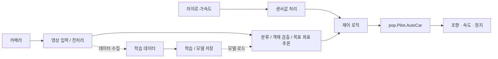

# AIoT AutoCar Prime

**Jetson 기반 차량 제어와 온디바이스 AI 실습**

카메라·관성 센서 입력이 인식 모델과 조향·구동 명령으로 이어지는 과정을 AIoT AutoCar Prime 플랫폼에서 학습한 기술 포트폴리오입니다. 한백전자 제공 교안과 예제를 바탕으로 차량 인터페이스, 데이터 수집, 모델 학습, 추론 콜백의 역할을 정리했습니다.

`Python` · `Jetson` · `OpenCV` · `TensorRT` · `Jupyter` · `pop.Pilot`

## Engineering Focus

| 영역 | 학습 내용 | 연결되는 기술 |
|---|---|---|
| 차량 인터페이스 | 조향·속도·전후진·정지, 카메라 방향 제어 | 하드웨어 API 및 액추에이터 제어 |
| 센서 입력 | 카메라 프레임, 자이로·가속도 정보 | 영상·관성 센서 처리 |
| 모델 학습 | 주행 이미지와 목표값 수집, 데이터셋 로드, 학습 | 데이터 수집–학습–추론 흐름 |
| 영상 기반 주행 | 충돌 회피, 객체 추종, 트랙·라인 추종 예제 분석 | 인식 결과의 제어 명령 변환 |
| 배포 환경 | Jetson 환경과 TensorRT 모델 로딩 구조 | 엣지 AI 실행 환경 이해 |

## Architecture

이 그림은 실습 예제의 공통 흐름을 묶은 구조도입니다. 각 주행 예제는 별도의 실습 단위입니다.

## Technical Notes

- [시스템 구조와 인터페이스](docs/architecture.md): 센서 입력과 제어 계층의 책임
- [실습 모듈별 동작 분석](docs/module-map.md): 충돌 회피·객체 추종·트랙 추종 비교
- [환경 구성과 실습 순서](docs/environment.md): 하드웨어 의존성과 데이터 흐름
- [자료 출처](REFERENCES.md): 제조사 교안·라이브러리·모델의 구분

## Repository Scope

공개 자료는 학습 내용을 재구성한 기술 문서입니다. 제조사 SDK·예제 전체·모델 바이너리와 교안 PDF는 포함하지 않습니다. 독자 개발한 자율주행 제품이나 실차 성능 벤치마크를 주장하지 않으며, **영상 인식과 차량 제어를 연결하는 시스템 이해**에 초점을 둡니다.
